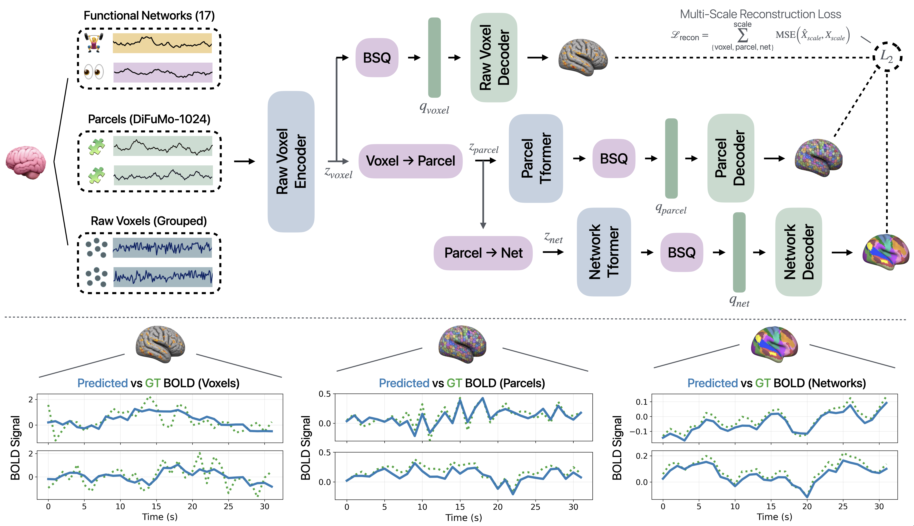

# HBAR: Hierarchical Brain Activity Representation

[](https://arxiv.org/abs/2611.11081)
[](https://neurips.cc/virtual/2026/loc/sydney/poster/153906)
[](https://karanps.com/hbar)



**Hierarchical tokenization and reconstruction for resting-state fMRI.** Voxel-level BOLD signals are
organized into a three-level hierarchy spanning sub-parcel voxel groups, parcels (DiFuMo-1024), and
large functional networks (Yeo-17). At each scale, tokens are discretized with binary spherical
quantization (BSQ) and decoded to reconstruct the corresponding signals.

## Abstract

We introduce HBAR (Hierarchical Brain Activity Representation), a hierarchical tokenization framework
for learning compact, multi-scale representations of neuroimaging data. HBAR organizes voxel-level
resting-state fMRI into a hierarchy spanning sub-parcel voxel groups, parcels, and large-scale
functional networks, enabling up to 415x compression while preserving fine-grained spatial information
beyond conventional parcellation. The framework supports fixed atlas-based, fully learned, and softly
prior-guided hierarchies, allowing us to systematically study the role of structured priors in brain
representation learning. On HCP-YA, at approximately 415x compression, HBAR achieves higher parcel and
network correlations than rate-matched flat tokenizers, while at a lower 52x compression rate,
shuffling the anatomical grouping reduces parcel correlation from 0.920 to 0.886. Demographic readouts
with autoregressive training also reveal potential gains from the hierarchical structure. By combining
sub-parcel inputs, compact discrete tokens, and multiscale brain structure, HBAR offers a practical
framework for representation learning in high-dimensional neuroimaging data.

## Repository

| Path | Contents |
|---|---|
| `train_fmri.py`, `trainer_fmri.py` | Training entry point and trainer |
| `models/fmri/` | Tokenizer models; HBAR is `model_npq_hier_residual.py`, quantizers in `bsq.py` / `quant.py` |
| `configs/fmri/` | Model configs for every row of the paper's tables, and data configs |
| `data/fmri_multiscale/` | Windowed dataset, atlas/layout construction, subject splits |
| `data/scripts/` | Dataset construction from fMRIPrep outputs |
| `data/subject_splits/` | The subject-level train/val/test split used in the paper |
| `downstream/` | Token codec, HCP metadata helpers, probe metrics |
| `scripts/eval/` | Reconstruction metrics, model-free baselines, significance tests, bit counts, latency |
| `scripts/downstream/` | Token export, atlas baselines, linear probes, autoregressive (AR) model |
| `scripts/training/train.sbatch` | Generic Slurm launcher |

## Installation

```bash
python3 -m venv .venv && source .venv/bin/activate
pip install -U pip
pip install -r requirements.txt
```

All commands below are run from the repository root.

## Data

We use one resting-state run per subject (the longest left-to-right run) from 1,096 HCP Young Adult
subjects, preprocessed with fMRIPrep to MNI152NLin2009cAsym at 2 mm. HCP data must be obtained from
the [Human Connectome Project](https://www.humanconnectome.org/) under its data use terms. The
subject-level split (877 train / 110 val / 109 test) is in
`data/subject_splits/hcp_ya_1096_80_10_10_seed0.json`; `scripts/make_subject_split.py` regenerates a
split from a dataset index.

Phenotypes (sex, and age in the three released bins) are read from a CSV with columns
`subject_id,age,sex`; see `data/hcp_metadata.example.csv` for the format.

Building the dataset:

```bash
# 1. Gray-matter mask resampled to the BOLD grid (edit the paths inside the script).
python3 data/scripts/gm_mask.py

# 2. Shared spatial layout: DiFuMo-1024 hard parcellation and 16-voxel sub-parcel chunks.
python3 data/scripts/build_multiscale_layout.py --gm_mask /path/to/gm_mask.nii.gz \
  --difumo_labels_csv /path/to/difumo_labels.csv --output_dir /path/to/build/layout_shared

# 3. Per-subject voxel / parcel / network series (shardable), then merge the shard indices.
python3 data/scripts/build_multiscale_hcpya.py --mode process_shard --root_dir /path/to/derivatives \
  --layout_dir /path/to/build/layout_shared --output_dir /path/to/build/shard_0000 \
  --num_shards 1 --shard_index 0
python3 data/scripts/merge_multiscale_shards.py --shards_root /path/to/build \
  --output_index /path/to/build/merged_index.json

# 4. Uncompressed float16 .npy arrays per subject and scale (memory-mapped by the loader).
python3 data/scripts/build_uncompressed_index.py --index_path /path/to/build/merged_index.json \
  --output_dir /path/to/build
```

Then set `index_path` (`/path/to/build/merged_index_uncompressed.json`) and `layout_dir`
(`/path/to/build/layout_shared`) in `configs/fmri/data.yaml`, `data_probe.yaml` and `data_ar.yaml`.
Networks are the 18 groups in the DiFuMo labels' `Yeo_networks17` column: the 17 Yeo networks plus
one group for parcels with no Yeo assignment.

## Models

| Paper row | Config | Compression |
|---|---|---|
| HBAR-52 (fixed) | `configs/fmri/hbar52_fixed.yaml` | 52x |
| Learned pooling | `configs/fmri/hbar52_learned.yaml` | 52x |
| Soft pooling (from scratch, σ = `align_scale` = 2.0) | `configs/fmri/hbar52_soft.yaml` | 52x |
| Shuffled grouping | `configs/fmri/hbar52_shuffled.yaml` | 52x |
| Flat BSQ-52 | `configs/fmri/baselines/flat_bsq52.yaml` | 52x |
| HBAR-415 (fixed) | `configs/fmri/hbar415_fixed.yaml` | 415x |
| Flat BSQ-415 | `configs/fmri/baselines/flat_bsq415.yaml` | 415x |
| Flat RVQ-415 | `configs/fmri/baselines/flat_rvq415.yaml` | 415x |
| MS-VQVAE-415 | `configs/fmri/baselines/ms_vqvae415.yaml` | 415x |

All models train for 10 epochs at learning rate 2e-4 with an effective batch size of 32
(`batch_size 4 x grad_accum_steps 4 x 2 GPUs`; use `--grad_accum_steps 8` on one GPU). We trained
three seeds (0, 1, 2) per row. Checkpoints are written every epoch as `ckpt_ep{epoch}_it{step}.pth`
and the final epoch is evaluated.

## Checkpoints

Pretrained HBAR-52 and HBAR-415 weights (fixed hierarchy, seeds 0–2) are on Hugging Face at
[karanps/HBAR](https://huggingface.co/karanps/HBAR), together with the shared spatial layout the
models were trained on:

```bash
hf download karanps/HBAR --local-dir checkpoints
```

To build data that matches the released models, pass `--layout_dir checkpoints/layout` to
`build_multiscale_hcpya.py` (step 3 above) and skip steps 1–2. The checkpoints load in every script
that takes a `.pth`, e.g. `--model hbar52_fixed:checkpoints/hbar52_fixed/config.yaml:checkpoints/hbar52_fixed/seed0.pth`.

## Training

```bash
torchrun --standalone --nnodes=1 --nproc_per_node=2 train_fmri.py \
  --config configs/fmri/hbar52_fixed.yaml --data_config configs/fmri/data.yaml \
  --output_dir runs/hbar52_fixed_seed0 --seed 0
```

or with Slurm:

```bash
MODEL_CONFIG=configs/fmri/hbar52_fixed.yaml OUT_DIR=runs/hbar52_fixed_seed0 SEED=0 \
  sbatch scripts/training/train.sbatch
```

Training logs to Weights & Biases if it is installed (`WANDB_DISABLED=1` turns it off); per-epoch
metrics are also written to `<output_dir>/metrics.jsonl`.

## Evaluation

### Reconstruction (Table 1) and frequency-resolved error (appendix)

Scores 16 windows for each of the 109 test subjects (1,744 windows), averages within subject and then
across subjects. Parcel and network predictions are formed by pooling the reconstructed voxels with
the atlas. The flat RVQ and MS-VQVAE rows use a bf16 forward pass, as in training and token export.

```bash
python3 scripts/eval/recon_metrics_per_subject.py --data_config configs/fmri/data.yaml --split test \
  --windows_per_subject 16 --seed 0 \
  --model hbar52_fixed:configs/fmri/hbar52_fixed.yaml:runs/hbar52_fixed_seed0/ckpt_ep0009_<step>.pth \
  --model flat_rvq415:configs/fmri/baselines/flat_rvq415.yaml:runs/flat_rvq415_seed0/ckpt_ep0009_<step>.pth \
  --autocast_models flat_rvq415 \
  --output_npz results/recon_test.npz --output_json results/recon_test.json

# Subject-bootstrap CIs and paired sign-flip tests between all models in the npz.
python3 scripts/eval/summarize_recon_table.py --npz results/recon_test.npz --pairwise \
  --output_json results/recon_test_cis.json

# Window-mean oracle and random reference rows, on the same windows.
python3 scripts/eval/recon_baselines_per_subject.py --data_config configs/fmri/data.yaml --split test \
  --windows_per_subject 16 --seed 0 --output_json results/recon_baselines_test.json
```

`recon_metrics_per_subject.py` also writes the per-band residual/input power ratios used in the
frequency-resolved appendix table (`voxel_loss_<band>`).

### Linear probes (Table 2)

Features are subject-level means of post-quantization codes over stride-64 windows
(`configs/fmri/data_probe.yaml`).

```bash
torchrun --standalone --nproc_per_node=1 scripts/downstream/precompute_fMRI_tokenization.py \
  --model_config configs/fmri/hbar52_fixed.yaml --checkpoint runs/hbar52_fixed_seed0/ckpt_ep0009_<step>.pth \
  --data_config configs/fmri/data_probe.yaml --out_dir tokens/hbar52_fixed_s0 --pooled_only --tag a

python3 scripts/downstream/linear_probe_hcp.py --pooled_npy tokens/hbar52_fixed_s0/pooled_a.npy \
  --hcp_metadata_csv /path/to/hcp_metadata.csv \
  --subject_split_json data/subject_splits/hcp_ya_1096_80_10_10_seed0.json --eval_split test \
  --output_json results/probe_hbar52_fixed_s0.json --predictions_npz results/pred_hbar52_fixed_s0.npz
```

Atlas baselines (Yeo network means, DiFuMo parcel means, parcel-series PCA, parcel-FC PCA), with
PCA fitted on training subjects only:

```bash
python3 scripts/downstream/export_baseline_pooled.py --data_config configs/fmri/data_probe.yaml \
  --name fc --fit_split train --out_dir tokens/baseline_fc   # also: yeo, difumo, pca
```

Paired comparisons between two probes' saved predictions:

```bash
python3 scripts/eval/paired_probe_significance.py --predictions_a results/pred_A.npz \
  --predictions_b results/pred_B.npz --name_a A --name_b B --output_json results/paired_A_B.json
```

### Autoregressive readout (Table 2)

Bottom-level token sequences are exported on non-overlapping 32-TR windows
(`configs/fmri/data_ar.yaml`), a causal model is trained on them with four windows of context, and a
probe is fit on its mean-pooled final hidden states.

```bash
torchrun --standalone --nproc_per_node=1 scripts/downstream/precompute_fMRI_tokenization.py \
  --model_config configs/fmri/hbar415_fixed.yaml --checkpoint runs/hbar415_fixed_seed0/ckpt_ep0009_<step>.pth \
  --data_config configs/fmri/data_ar.yaml --out_dir tokens_ar/hbar415_fixed_s0 --tag a --save_pooled

python3 scripts/downstream/train_token_ar.py --token_dir tokens_ar/hbar415_fixed_s0 --tag a \
  --n_context_windows 4 --patch_size 64 --epochs 10 --hidden 256 --layers 4 --heads 4 --lr 5e-5 \
  --warmup_steps 200 --lr_decay cosine --batch_size 8 --amp --seed 0 \
  --subject_split_json data/subject_splits/hcp_ya_1096_80_10_10_seed0.json \
  --hcp_metadata_csv /path/to/hcp_metadata.csv --output_dir ar/hbar415_fixed_s0 \
  --readout --readout_fit_split train --readout_eval_split val

# Test readout from the trained AR model.
python3 scripts/downstream/train_token_ar.py --token_dir tokens_ar/hbar415_fixed_s0 --tag a \
  --n_context_windows 4 --patch_size 64 --hidden 256 --layers 4 --heads 4 --seed 0 \
  --subject_split_json data/subject_splits/hcp_ya_1096_80_10_10_seed0.json \
  --hcp_metadata_csv /path/to/hcp_metadata.csv --output_dir ar/hbar415_fixed_s0 \
  --readout --readout_only --readout_fit_split train --readout_eval_split test \
  --predictions_npz ar/hbar415_fixed_s0/readout_test_predictions.npz
```

### Bit accounting and latency

```bash
# Stored bits per window, counted from the quantized tensors of a randomly initialized model.
python3 scripts/eval/check_code_shape_bits.py --data_config configs/fmri/data.yaml \
  --config configs/fmri/hbar52_fixed.yaml --config configs/fmri/hbar415_fixed.yaml \
  --out_json results/code_shape_bits.json

python3 scripts/eval/bench_inference_latency.py --data_config configs/fmri/data.yaml \
  --model hbar52_fixed:configs/fmri/hbar52_fixed.yaml:runs/hbar52_fixed_seed0/ckpt_ep0009_<step>.pth \
  --output_json results/latency.json
```

## Citation

```bibtex
@misc{singh2026hbar,
  title={A Hierarchical Tokenization Framework for Voxel-Level fMRI Representation Learning}, 
  author={Karanpartap Singh and Yue Zhao and Mohammad H. Abbasi and Ehsan Adeli},
  year={2026},
  eprint={2611.11081},
  archivePrefix={arXiv},
  primaryClass={cs.LG},
  url={https://arxiv.org/abs/2611.11081}, 
}
```

## License

MIT; see [LICENSE](LICENSE).
